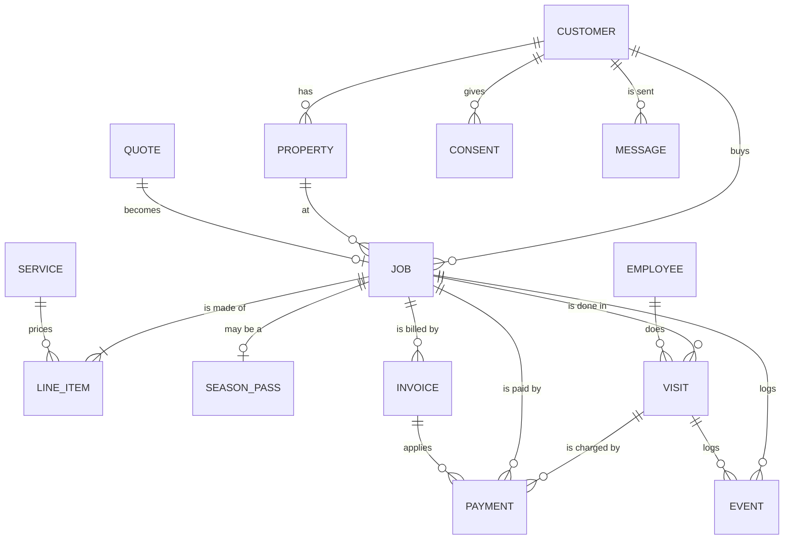

# The data model, v2: the nouns the business runs on

Hannah, 16 Nov 2026: "I think you need to think about the data structure
of a customer, of a job… I want customizable in ours. I hate that jobs
are really confusing. Simplicity is better, but it feels like our data
model doesn't have everything we need… This is going to be the
foundation of what we do, so it needs to be excellent."

This is the conceptual model: the nouns, what each one is for, how they
relate, and what is customisable. Columns and indexes stay in
`src/db/schema.ts` and the per-field contract stays in `DATA_MODEL.md`.
Method: nouns first, one job per noun, nothing a person at Trailhead
would not name in a sentence (the KISS rule of the data-model-architect
skill Hannah pointed at), checked against Jobber's own objects (read
through its API on 16 Nov: Client, Property, Request, Quote, Job with
line items, Visit, Invoice with payments, Product or service, User) so
nothing Jobber needed for this business is missing, and nothing Jobber
makes people do (an invoice to close a job) is forced.

## The sentence

**A customer** has **properties**. We sell them a **job** made of **line
items** from our **services**. A job is done in one or more **visits**,
each by an **employee** on a day. Money comes in as **payments**. When
someone needs paper, an **invoice** is written from the job and the
payments are applied to it. Everything that happens is a dated **event**
with a person's name on it, and **messages** go out and come in along
the way.

## The nouns

| Noun | What it is | Today | What changes |
|---|---|---|---|
| **Customer** | The person who pays and is messaged. Name, email, phone, lead source, Stripe customer, marketing consent (in Consent), tags. | `customer` | Add `tags` (text list, Hannah's own words: "HOA", "realtor", "pays by check") and `notes`. The pass's `needs_customer_home` and `access_note` move to Property. |
| **Property** | Where the work is. Address, town, zip, point, zones, controller, backflow location, gate code, "someone must be home", access note, notes. One customer, many properties (landlords, second homes). | `property` (address, town, point) | Add `zip`, `zones`, `controller`, `backflow_location`, `gate_code`, `needs_customer_home`, `access_note`, `notes`. Zones belong to the property, not the pass: the pass reads them. |
| **Service** | The catalogue Hannah edits: name, kind, description (what the visit includes and what it does not, Ryan's Jobber text), price rule (price, included zones, extra zone price, or quote only), minutes, bookable, active. | `service` | Add `description`, `active`. The price rule renders every price line on the site, the sheets, the invoice; nothing is typed twice. |
| **Job** | The sold work, the order: who, where, what was sold, for how much, where it came from, its state. Line items say what; a job with one line is the common case. A Season Pass is a job whose pass record adds season, add-on, card and renewal. Status: open, done, cancelled. | `job` (kind, one price) + `season_pass` | Add **Line item** (service, name, description, quantity, unit price, total; copied from the service at sale so later catalogue edits do not rewrite old jobs) and `total` derived. Source gains `renewal`. The pass keeps only what is pass-specific. |
| **Visit** | The stop: one job, one property, one day, one employee, a time or any time, minutes, route order, status (no day yet, scheduled, done, not done with reason, cancelled), what was done, photos. The word Hannah chose. | `visit` | `truck_id` becomes `employee_id`; `amount` stays as the visit's share of the job (what is charged after it); add `done_by` (who marked it). Jobber ids stay until the exit. |
| **Employee** | The hierarchy for the schedule: name, phone, email, role (owner, tech), truck, working days, capacity by kind, season start and end, sign-in. | `truck` + `admin_user` | New table; backfill Truck 1 to Ryan Garner, Truck 2 to the fall-only second person; `admin_user` becomes the sign-in half of an employee. |
| **Payment** | Money that came in: for a visit (a pass charge after the stop) or a job (a one-off paid at the door), amount, method (card on file, card now, check, Venmo, cash), reference, Stripe ids, status, receipt. Attempts are rows. | `charge` | Rename in words to Payment (the table can keep its name); add `job_id` so a one-off paid as a whole has one row; `bill` stops being a method and becomes an Invoice. |
| **Invoice** | A document, only when a customer needs one: the job's line items as of sending, amount due, due date, sent at, paid at, the payments applied. "Send a bill" makes one; a paid invoice is the receipt. Never required to close a job (the simplicity rule). | mirror of Jobber's only | New table, phase after the pass sale. Until then "Bill sent" is a note on the job. |
| **Quote** | For work priced on site: line items, total, sent, approved, declined; approval makes the Job. | mirror of Jobber's only | New table, later; installs and big repairs run through Jobber until then. |
| **Consent** | Terms accepted and marketing choice, with source and version. | `consent` | Unchanged. |
| **Message** | A text or email, out or in, with its template data and delivery state. | `message_log` | Unchanged; `visit_id` gains `job_id` so job-level messages (a bill) attach. |
| **Event** | What happened and who did it: day moved, done, not done, paid, card failed, note added. One table for customer, job, visit and payment. | `pass_change` (passes only) | Generalise to `event` with `about` (customer, job, visit, payment) and `about_id`; the panels' history reads it. |
| **Note** | A dated note by a person on a customer, property, job or visit (Jobber's "Linked note"). | free-text columns | Notes are events of kind `note`; the free-text columns stay for the summary line. |
| **Attachment** | A photo from the stop or a file on a job. | none | Event with a file; later, when the crew view exists. |
| **Season** | The year's windows (turn-on, inspection, blowout), lead weeks, route days per town. | `organization.settings` + `area` | Route days move onto Employee. |
| **Needs action** | What the office must act on now. | `admin_alert` + derived rows | Unchanged. |

## Customisable, without a schema change

Hannah's "I want customizable in ours", kept simple:

- **Services** are rows Hannah edits in Settings: add one, rename, change
  the price rule, the minutes, the description, retire it. The sheets,
  the site's price lines and the invoice read them.
- **Tags** on customers and jobs: free words, filterable, exportable. No
  custom-field builder until tags prove too thin.
- **Statuses are fixed** on purpose. Jobber's "late, active, requires
  invoicing" is what Hannah hates. A visit is no day yet, scheduled, done,
  not done, cancelled; money is unpaid, paid (how), failed; a job is
  open, done, cancelled. Nothing else, nowhere.
- **Line items** make a job describable without new kinds: "Repair
  assessment $145" plus "Labor 2 h $290" plus "Materials $38" is three
  rows, not a new job type.

## The diagram

## What Jobber has that we leave out, on purpose

Requests (a form that becomes a quote): our website books a visit or
asks for a quote by contact form; a Request table is noise. Recurring
job schedules: the Season Pass is the only recurrence and it is two or
three visits a year, so visits are rows, not a rule. Expenses, timesheets,
GPS: not this product. Invoice required to close: never.

## The order to build it (each step ships alone)

1. **Employee** (build 2's data step): visits assigned to a person; the
   schedule, day view and messages name them.
2. **Service.description** and **line items on the job**: the sheets and
   the panels show what was sold and what it includes; the pass sale
   (built 16 Nov) writes two or three line items.
3. **Property** takes zones, access, gate code and "must be home" from
   the pass; the checkout writes them there.
4. **Payment** gains `job_id`; **Invoice** replaces "bill" as a method;
   the customer gets a page to pay a bill by card.
5. **Event** replaces `pass_change` for every record; notes become events.
6. **Quote**, when installs leave Jobber.

Every step updates `DATA_MODEL.md`'s rows for the fields it moves, and
nothing is renamed in the API without an alias for a season.
